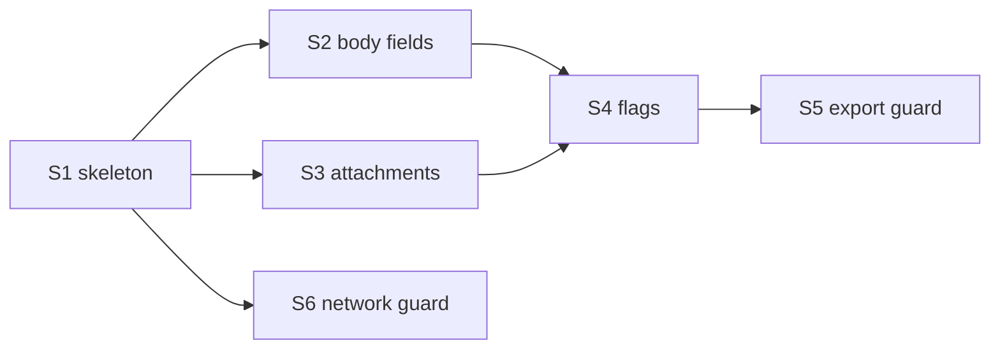

# Plan: RFQ intake

*A record of the order of work. `spec.md` states what must be true and stays current. This file is history once the build is done.*

## How to run this

**One agent.** Paste this to start:

> Read `spec.md`, `contracts/quote_request.ts`, `checks/rules.md` and this file. Work the slices below in order. A slice is done when the checks it names pass under `make check` and no check that passed before now fails. Tick its box and add its evidence line. Do not edit anything under `checks/` and do not read `checks/holdout/`. When an open question in `spec.md` blocks you, apply its default and record that in the decision log. Stop when every slice is ticked.

**Several agents.** Give each slice to one builder. A builder starts only when every slice it depends on is ticked, and it writes only inside the paths its slice owns. One verifier that wrote none of the code runs `make check` on each finished slice and holds the held-back cases. Slices merge in dependency order, and a slice counts only after `make check` passes on the merged branch.

## Setup

- **Repository:** new, with `make check` wired to run `checks/`. Slice 1 creates both.
- **Test data:** the emails in `checks/cases.yaml`. Nothing else is needed.
- **Allowed without asking:** write files inside the repository, install open-source packages, run `make`.
- **Not available:** secrets, paid accounts, and any service outside the network (see `spec.md`, R4).

## Stop rules

- Three failed attempts at the same check: stop that slice, record what was tried in the decision log, and move to a slice that does not depend on it.
- A check that contradicts a requirement, or a decision in `spec.md` that proves wrong: stop and ask. Do not change `spec.md` or `checks/` to get past it.
- Every slice ticked, or no slice left that can start: stop and report the score line.

## Slices

S2, S3 and S6 can run at the same time. They own different paths.

### S1. Walking skeleton

- **Delivers:** `ingest(email)` exists and returns an empty draft. `make check` runs every case and rule and prints the score line.
- **Depends on:** nothing.
- **Owns:** `Makefile`, `checks/run/`, `src/ingest.ts`.
- **Turns green:** none yet. The score reads `cases 0/6`, and that is correct.
- **Evidence:** the score line from `make check`.

### S2. Fields from the email body

- **Delivers:** customer, part numbers, revisions, quantities and due date from the body, including forwarded text.
- **Depends on:** S1.
- **Owns:** `src/extract/body/`.
- **Turns green:** C01, C06, and the body half of C02.
- **Evidence:** the score line, with the case ids that changed.

### S3. Attachments

- **Delivers:** each attachment stored with a hash and linked to its line item by filename.
- **Depends on:** S1.
- **Owns:** `src/extract/attachments/`.
- **Turns green:** C02, C04.
- **Evidence:** the score line.

### S4. Flags

- **Delivers:** missing and conflicting fields are left empty and flagged.
- **Depends on:** S2, S3.
- **Owns:** `src/flags/`.
- **Turns green:** C03, C05, rule RU1.
- **Evidence:** the score line.

### S5. Export guard

- **Delivers:** `export` refuses a request with an open flag and writes a JSON file otherwise.
- **Depends on:** S4.
- **Owns:** `src/export/`.
- **Turns green:** rule RU3, and `exportable: false` in C05.
- **Evidence:** the score line, plus one exported file.

### S6. Network guard

- **Delivers:** the test run blocks outbound calls, and extraction for an export-controlled customer makes none.
- **Depends on:** S1.
- **Owns:** `src/net/`, `checks/run/network.ts`.
- **Turns green:** rule RU2.
- **Evidence:** the score line.

## Progress

- [ ] S1
- [ ] S2
- [ ] S3
- [ ] S4
- [ ] S5
- [ ] S6
- [ ] Reviewer ran the held-back cases: __ of 4

## Decision log

| When | Decision | Why |
| --- | --- | --- |
| | | |
