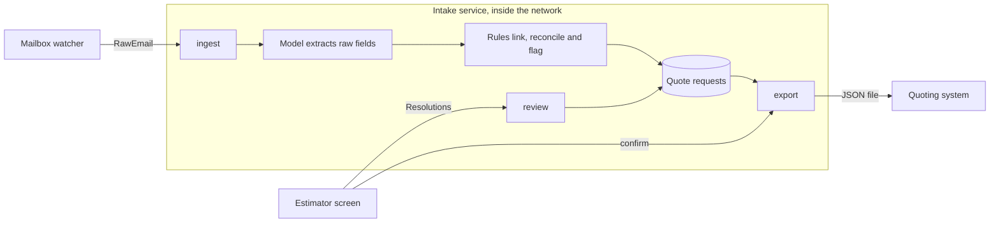
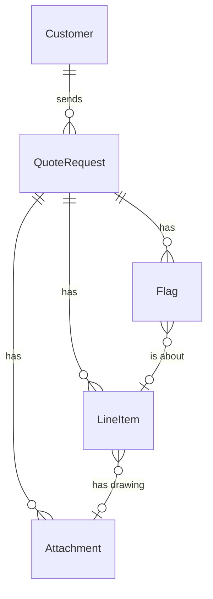

# Spec: RFQ intake

*Living document. This file states what must be true. `plan.md` states the order of work.*

This is an invented example to show the file set. The company and numbers are made up.

## Problem

Estimators at a machine shop receive requests for quote (RFQs) by email, each with drawings attached. They retype the part numbers, quantities and due dates into the quoting system. It takes about 20 minutes per RFQ, and typos reach the customer.

## Outcome

An email arrives and becomes a draft quote request that an estimator confirms in under 2 minutes. Estimators notice. Nothing reaches the quoting system without a person confirming it.

## Out of scope

- Pricing the quote.
- Reading dimensions from drawings.
- Replying to the customer.

## Requirements

Each requirement names the checks that prove it. Check ids refer to `checks/cases.yaml` and `checks/rules.md`.

| Id | Requirement | Proven by |
| --- | --- | --- |
| R1 | The system extracts customer, part numbers, revisions, quantities and due date from the email body and attachment names. | C01 to C06 |
| R2 | A field the email does not state is left empty and flagged. The system never guesses it. | C03, C05, rule RU1 |
| R3 | Every attachment is stored with a hash and linked to its line item when the filename matches a part number. | C02, C04 |
| R4 | A request from an export-controlled customer is never sent to a service outside the network. | rule RU2 |
| R5 | A request cannot be exported while it has an unresolved flag. | C05, rule RU3 |

## Decisions already made

| Decision | Choice | Why | Hard to reverse? |
| --- | --- | --- | --- |
| Data model | The shape in `contracts/quote_request.ts`: a flag is its own record and can point at one line item | Lets each rule be tested without a model. A single-pass design lost because a flag could not point at a field. A prefilled form lost because it misses the 2-minute outcome. | Yes |
| Where extraction runs | A model inside the network | R4 | Yes |
| Review step | Always, for version one | Outcome above | No |

## Design

Fields and call signatures live only in `contracts/quote_request.ts`. These two diagrams show what the types cannot: how the parts connect.

## Left to the builder

Language and framework inside the service, the parsing approach for each field, file layout, and test structure. Any of these may change without asking.

## Terms

- **RFQ:** request for quote, the customer's email.
- **Line item:** one part number with its revision and quantity.
- **Flag:** a note that a person must resolve before export.

## Open questions

| Question | Default until answered | Who answers |
| --- | --- | --- |
| Does the quoting system accept an import file, or only its API? | Stop at a JSON file per request | Operations lead |
| Are quantities ever given as ranges ("50 to 100")? | Store the text, flag it | Lead estimator |

## Done when

`make check` exits 0, the held-back cases pass when the reviewer runs them, and an estimator has confirmed three real requests end to end.
